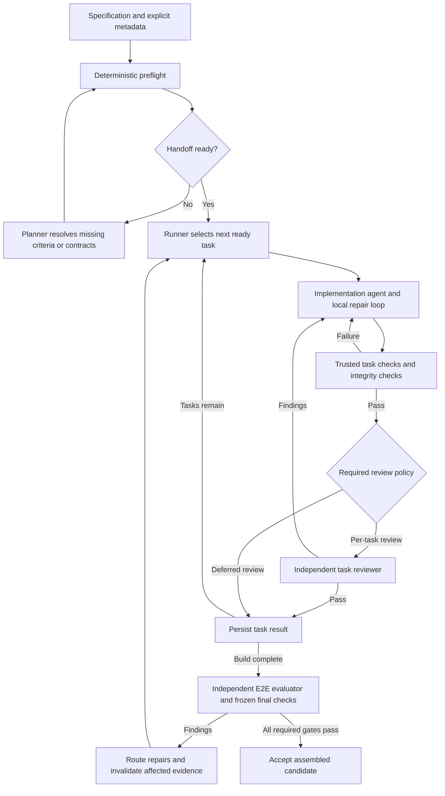

# Spec Source Suite: alignment with current agentic development practice

Research date: 2026-11-06. Scope: the current `spec-source-suite/` working tree, primary-source research, and official implementation documentation. This is an assessment and proposed direction, not a workflow change or approval of a new execution policy.

The repository HEAD was `e63405b4205b0f965879f37e739e3a161ab7f47a`. Several suite documents already had uncommitted changes; this assessment uses their working-tree contents. No historical app task records, run evidence, or conversations were searched. No app benchmark was executed, so this report makes no measured claim about this suite's quality, token savings, or runtime.

## Assessment

The suite has strong verification and provenance rules, but implements much of its control flow as instructions to an LLM. Its main opportunity is to turn existing rules into executable machinery and then measure which remaining agent roles improve outcomes.

Both proposed improvements are well motivated:

1. Add machine-checkable specification structure and execution metadata, using OpenSpec or an equivalent typed format.
2. Replace routine supervisor coordination with a deterministic runner. Separately evaluate whether independent review can move from every task to the completed application for suitable workloads.

These are separate changes. Removing the supervising LLM need not remove any current verification gate. Removing per-task independent review changes the assurance policy and requires evidence that final verification catches the defects that matter.

There is no single demonstrated best architecture across repository repairs, greenfield apps, and long-running development. First-party reports support simplifying harnesses as models improve; controlled research also makes the case for workload-specific evaluation. The companion [research evidence note](agentic-development-evidence.md) records the broader empirical sources and their limits.

## What the suite already gets right

| Area | Current evidence | Assessment |
|---|---|---|
| Specification authority | [Contract §1](../spec-source-suite/docs/SUITE_CONTRACT.md#1-authority-and-readiness) separates approved requirements from derived plans | Preserve. Implementation plans must not silently redefine success. |
| Feedback through execution | [Contract §4](../spec-source-suite/docs/SUITE_CONTRACT.md#4-checks-and-repairs) requires public-interface tests and repairs | Strong foundation for agent feedback. |
| Whole-application validation | [Generate G4](../spec-source-suite/docs/GENERATE.md#g4-verify-assembled-app) requires independently executed final scenarios | Already present; the proposal changes when other evaluation happens, not whether final E2E exists. |
| Independent evaluation | [Reviewer](../spec-source-suite/prompts/REVIEWER.md) excludes implementation narratives and checks coverage | Valuable defense against self-assessment bias; frequency should be evaluated. |
| Durable state | [Contract §5](../spec-source-suite/docs/SUITE_CONTRACT.md#5-acceptance-and-durable-evidence) binds evidence to actual inputs/candidates and preserves failed attempts | Well suited to an automated runner. |
| Context control | [Role manifests](../spec-source-suite/docs/HELPERS.md#role-context) and [curated memory](../spec-source-suite/docs/PROJECT_MEMORY.md) scope reads and retain selected inputs | Good design intent; measure actual context cost and completeness. |
| Basic deterministic machinery | [check_execution.py](../spec-source-suite/helpers/check_execution.py), [role_context.py](../spec-source-suite/helpers/role_context.py), and [usage_report.py](../spec-source-suite/helpers/usage_report.py) | Reuse these rather than rebuilding the whole system. |

Anthropic's November 2025 long-running-agent report emphasizes incremental progress, durable handoffs, and testing through actual application interactions. These correspond closely to existing suite policies. It is an engineering case study, not proof that every suite rule improves performance. [Source](https://www.anthropic.com/research/effective-harnesses-for-long-running-agents).

## Proposal 1: machine-checkable specifications

### The concrete gap

[MARKDOWN_BUNDLES.md](../spec-source-suite/docs/MARKDOWN_BUNDLES.md) deliberately accepts ordinary prose without required frontmatter. Dependencies may appear in prose, and requirement IDs/check mappings are derived later. The supervisor is instructed to validate these relationships.

The existing helpers validate role manifests and check manifests. For example, `check_execution.validate()` rejects unknown requirement mappings, duplicate IDs, and missing mandatory mappings. However, the inspected package has no executable source-bundle parser/validator or runner that enforces the complete task-readiness and acceptance policy. Structural validation exists downstream, but not as a complete preflight before agents are launched. [Helper scope](../spec-source-suite/docs/HELPERS.md).

### What OpenSpec actually supplies

I inspected OpenSpec documentation and source at commit `3e4d5f0769e2857c8eb54f149cbf5e4f703fa04c`, dated November 4, 2026. This is a source snapshot, not a claim that every feature is in an installed/released package. No OpenSpec installation or execution was performed.

Its CLI exposes noninteractive structured validation:

```sh
openspec validate --all --strict --json --no-interactive
```

It also exposes workflow status and custom schema validation. Artifact completion status is explicitly distinct from implementation completion. [Pinned CLI documentation](https://github.com/Fission-AI/OpenSpec/blob/3e4d5f0769e2857c8eb54f149cbf5e4f703fa04c/docs/cli.md).

The implementation parses Markdown and checks structured requirements, scenario presence/steps, duplicate or conflicting delta operations, and other format/change rules. Strict mode treats warnings more strongly. These checks do not execute the app or establish semantic completeness. [Validator source](https://github.com/Fission-AI/OpenSpec/blob/3e4d5f0769e2857c8eb54f149cbf5e4f703fa04c/src/core/validation/validator.ts).

Its workflow-schema loader checks duplicate artifact IDs, unknown dependencies, and cycles. Those edges connect specification artifacts; they are not automatically the suite's implementation-task graph, accepted dependency identities, or regression obligations. [Artifact schema source](https://github.com/Fission-AI/OpenSpec/blob/3e4d5f0769e2857c8eb54f149cbf5e4f703fa04c/src/core/artifact-graph/schema.ts).

### Recommended integration

Use OpenSpec as an authoring/change-management frontend if its conventions fit the project. Keep a separate, versioned execution manifest for suite-specific information:

- Task IDs, explicit prerequisites, and selected scope.
- Source requirement references and source digests.
- Candidate ownership and protected paths.
- Required interface/dependency identities.
- Frozen check inventories and requirement/check mappings.
- Review policy, applicable manual gates, and resource limits.

The runner can validate these fields before launching an implementation agent. It can reject malformed references, cycles, missing mandatory checks, stale identities, and conflicting ownership without paying for model reasoning.

Some checks belong earlier than others. Before **any** model call, syntax and explicit metadata can be checked. Semantic acceptance criteria and executable tests may still need an author/planner. Before an **implementation** call, validate the completed handoff and frozen checks again. No parser can deterministically recover an unexpressed dependency or resolve contradictory natural-language intent.

Avoid two editable sources of truth. If OpenSpec becomes authoritative, generate any legacy bundle views and bind them to source identities. An initial lower-disruption alternative is typed metadata alongside existing Markdown, with a validator that preserves the current bundle contract. OpenSpec is useful infrastructure; adopting its brand is not itself an effectiveness result.

## Proposal 2: replace central supervision with a runner

### What is unnecessarily agent-mediated today

[Generate G2–G3](../spec-source-suite/docs/GENERATE.md) assigns graph validation, ready-task planning, dispatch, and acceptance to the supervisor. [Contract §2](../spec-source-suite/docs/SUITE_CONTRACT.md#2-roles-and-context) requires that supervisor to retain planning context. The [helpers explicitly exclude scheduling and acceptance](../spec-source-suite/docs/HELPERS.md).

Task ordering, checking prerequisites, constructing manifests, dispatch, collecting receipts, checking hashes, rerunning declared checks, and recording state transitions can be ordinary code once their policy and inputs are explicit. Coverage judgments, ambiguous requirements, novel interfaces, and disputed verifier results still need reasoning.

Anthropic's workflow guidance distinguishes predefined control paths from model-directed orchestration and recommends using the simplest sufficient design. This supports code for known coordination steps while retaining agent judgment where the work cannot be predetermined. [Building effective agents](https://www.anthropic.com/research/building-effective-agents).

### End-of-build evaluation has direct supporting evidence

Anthropic's March 24, 2026 report moved from sprint-by-sprint evaluation to end-of-build evaluation with a stronger model, retaining multiple build/QA rounds. This supports testing the proposed architecture; the case study does not establish equivalent quality for this suite. [Harness design for long-running application development](https://www.anthropic.com/research/harness-design-long-running-apps).

More recent October 22 guidance reports benefits from reducing router/planner/domain subagents in some enterprise deployments, while preserving verification and fresh-context work where useful. Its proposed main-agent loop differs from a deterministic task runner: the shared lesson is to measure the value of each coordination boundary, not assume the architectures are interchangeable. [When to fold subagents into your main agent loop](https://claude.com/resources/articles/building-agents-when-to-fold-subagents-into-your-main-agent-loop).

### Recommended architecture



This is a proposed design, not an implemented runner. Start with a serial loop: the existing bundle already imposes a dependency on the preceding task. Removing the supervisor does not require parallel execution or changing those dependencies.

The runner needs persistent attempts, identity-bound receipts, safe resume behavior, and explicit budget/timeout handling. A worker's exit code or claim of completion cannot alone unlock downstream work. Enforce gates from trusted evidence; keep judgment results as separately identified inputs. Persist model-made interface decisions so the next worker does not need a supervising conversation to recover them.

For a deferred-review mode, distinguish **task checks passed** from **independently accepted**. The current contract forbids unreviewed prerequisites from unlocking consumers. Allowing provisional task results to feed later tasks therefore needs a deliberate new policy; do not relabel them as accepted under the old one. Preserve task-level behavioral and interface checks even when the review agent runs only at the end. Deferring all testing would amplify integration failures and make repair attribution harder.

Keep a planner available on demand. Existing planning is just-in-time because downstream checks may need actual upstream contracts. A loop can invoke that reasoning only when needed; it need not prewrite every detailed plan or retain a continuously supervising agent.

## Additional priorities

**Measure required instruction overhead.** Every role manifest requires the shared contract; it is approximately 1,476 whitespace-separated words in this snapshot, before role instructions and app inputs. This is not a token count or cost estimate. Move mechanically enforced policies into code and retain concise, role-relevant instructions. The September 2026 revision of *Evaluating AGENTS.md* reports no general success improvement and increased inference cost in its studied settings; this motivates ablation, not deleting necessary project conventions. [Paper, v3](https://arxiv.org/abs/2602.11988v3).

**Enforce the boundaries that automation relies on.** The suite correctly distinguishes digest checks from a sandbox. For unattended execution, protect frozen checks and reviewer results through actual write permissions or isolated execution, not only role instructions. Use stronger separation where the threat model requires it; a separate Git worktree alone does not stop writes elsewhere. This follows the suite's own [strong-isolation design](../spec-source-suite/docs/STRONG_ISOLATION.md).

**Calibrate evaluators.** A fresh context does not remove correlated model errors. Assess whether evaluators catch known defects and whether their findings are reproducible. Keep deterministic final scenarios alongside exploratory E2E assessment, including non-UI requirements that browser testing alone cannot establish. Existing [coverage/review distinctions](../spec-source-suite/docs/SUITE_CONTRACT.md#5-acceptance-and-durable-evidence) are worth preserving.

**Do not infer savings from agent count alone.** Removing coordination calls should reduce that category of model work, but later repair loops may offset it. Measure total cost per successfully completed app, including checks, retries, evaluator calls, and planning.

## Suggested adoption and evaluation order

| Step | Change | What it establishes |
|---|---|---|
| 1 | Add a bundle/execution schema and deterministic preflight | Invalid inputs fail before implementation calls. |
| 2 | Add a serial runner while retaining existing per-task reviews | Isolates the effect of removing central LLM coordination. |
| 3 | Compare per-task review against deferred/risk-based review | Tests whether review frequency buys enough defect detection to justify cost. |
| 4 | Reduce repeated policy context and unnecessary handoff documents | Tests instruction and context overhead independently. |
| 5 | Consider concurrency only for explicitly independent tasks | Avoids conflating orchestration simplification with parallel integration risk. |

Use representative CLI, stateful API, and UI builds with identical briefs, frozen verification, models/settings, and comparable budgets. Run repeated trials and report first-attempt and eventual success, escaped defects, manual interventions, total/cached tokens, cost, wall time, and repair effort. Keep failed and blocked runs in the results. Use a held-out evaluation set or independent defect audit to avoid choosing the architecture that merely fits its own checks. Predeclare acceptable quality differences; a small pilot can guide engineering but cannot prove equivalence.

The relevant existing change points are the root `AGENTS.md`, suite router/README, `MARKDOWN_BUNDLES.md`, contract §§2–5, `GENERATE.md`, `DEFINE.md`, `PLANNING.md`, implementer/reviewer handoffs, and helper manifest schemas. Changing reviewer frequency affects acceptance semantics; adding scheduling alone can preserve them.

Recommended first investment: a typed preflight plus a small serial runner built around the existing helpers. Then test the user's end-of-build review policy against the current stronger policy. Preserve the suite's evidence discipline while measuring how much agent coordination it actually needs.
